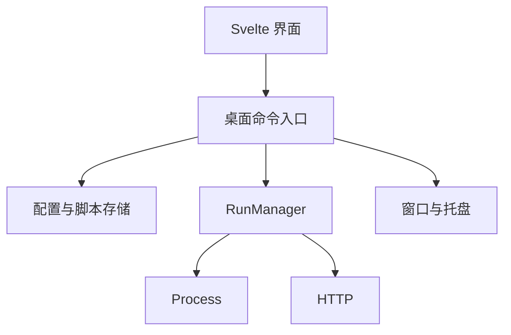

# 架构边界

bullet 的使用入口只有文本和已配置动作。多步业务任务由用户脚本或 CLI 实现；配置描述调用、输入与返回，避免引入工作流语言。

## 为什么按责任拆分

按翻译、思源、PI 拆分会分别实现取消、输出与历史，新增用途会放大修改范围。按执行生命周期拆分，让新增用途主要成为配置变化；代价是复杂业务逻辑需要外部程序或托管脚本完成。

| 决策 | 唯一责任位置 | 更改时的影响 |
| --- | --- | --- |
| 配置语义、校验、冲突 | [/src-tauri/src/config/model.rs](/src-tauri/src/config/model.rs)、[/src-tauri/src/config/mod.rs](/src-tauri/src/config/mod.rs) | GUI 可以提供编辑便利，但 Rust 校验为提交边界 |
| cwd 与程序路径 | [/src-tauri/src/config/paths.rs](/src-tauri/src/config/paths.rs) | CLI、Script 共用，窗口启动方式不参与 |
| 任务状态、输出累计、历史 | [/src-tauri/src/execution/mod.rs](/src-tauri/src/execution/mod.rs) → `RunManager` | 关闭视图不影响任务；换前端也保留执行规则 |
| 系统进程、网络返回协议 | [/src-tauri/src/execution/process.rs](/src-tauri/src/execution/process.rs)、[/src-tauri/src/execution/http.rs](/src-tauri/src/execution/http.rs) | uv、PI 无特殊分支；新增 HTTP 协议在执行端解析 |
| 屏幕几何与窗口 | [/src-tauri/src/desktop/shell.rs](/src-tauri/src/desktop/shell.rs) | Svelte 提交期望高度；桌面端决定实际位置和尺寸 |
| 配置草稿、视图转换、提交进度 | [/src/lib/config-editor.svelte.ts](/src/lib/config-editor.svelte.ts) | 管理窗口持有编辑会话，页面只渲染；新增字段不各自实现保存或版本规则 |
| 前端连接与显示模型 | [/src/lib/bridge.ts](/src/lib/bridge.ts)、[/src/lib/types.ts](/src/lib/types.ts) | browser bridge 明确为模拟，原生通过 commands/Channel |

配置 Script 先冻结一个源文件版本，再复用 Process。版本文件属于 `.config/bullet`，不向用户工作目录散落临时脚本；运行中的版本不被源码编辑覆盖。

## 配置编辑与磁盘状态

前端编辑会话拥有未保存草稿，Rust 拥有已提交配置与配置语义。表单和 JSON 是同一草稿的编辑方式；文本输入允许暂时无效，但视图转换和提交必须由会话协调。源码草稿按动作与扩展名区分，不随当前页面销毁。异步编辑操作串行执行，界面在操作中禁用输入，避免迟到响应覆盖新内容。

`revision` 表示最后有效配置，`diskRevision` 和 `diskStatus` 表示当前磁盘文件。无效磁盘文件仍可回退执行，但不能普通保存；显式恢复先备份原始内容，再复查磁盘版本并替换。配置与脚本不是跨文件事务，提交进度必须报告部分成功。文件错误包含目标路径和失败阶段，不自动重试或修改文件权限。

保留配置 version 1、脚本目录与执行边界。不引入共享草稿服务、后台文件监视器、自动冲突合并或草稿磁盘持久化；若以后需要多窗口共享编辑，再重新评估会话归属。

## 原生窗口取舍

气泡、输入面板分别使用无边框置顶窗口，管理窗口按需创建。拆分隔离拖动锚点和面板大小，保持气泡可点击；代价是多个 WebView 的内存与跨窗口通信。管理窗口关闭时隐藏，保留未保存编辑；启动后不预建管理窗口。

WebView 中的透明区域不等于原生窗口鼠标穿透。面板尺寸随内容变化，裁剪到工作区；不创建覆盖桌面的透明窗口。菜单有自己的滚动容器，并在请求原生高度时计入尺寸。多屏命中与 DPI 变化仍须原生验收。

## 有意保留的限制

- 一个前台视图，可并行运行最多 16 个任务，达到上限直接拒绝新任务。
- 历史为有界 JSON，不提供任务队列、崩溃后续跑或独立后台服务。
- 托管脚本第一版是单文件；运行快照的 `__file__` 指向版本目录。需要项目文件时配置 cwd 并由脚本读取该目录。
- CLI stdout 为文本，编码可选。PI print 可直接使用；CLI 的结构化 JSONL 事件没有专用适配器。HTTP 支持 JSONL/SSE 的配置提取。
- 系统通知提供完成/失败提示，Windows 通知点击精确定位任务尚未实现。结果由任务入口查看。

这些限制对应当前消费者，不预建插件注册表、通用表达式引擎或复杂 provider 层。
